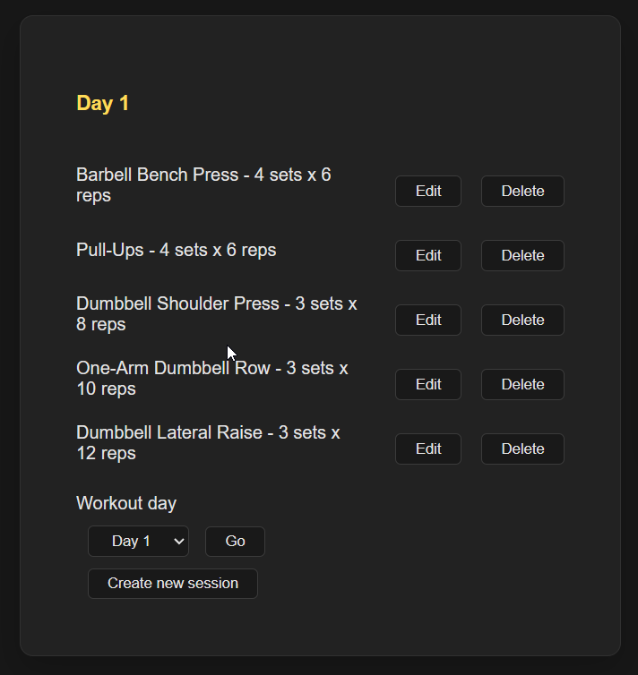
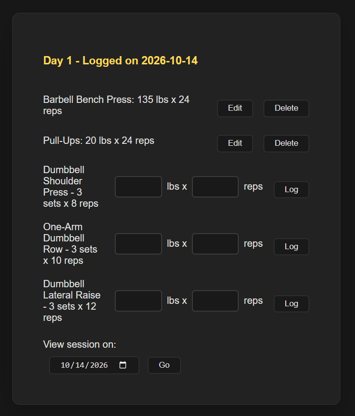
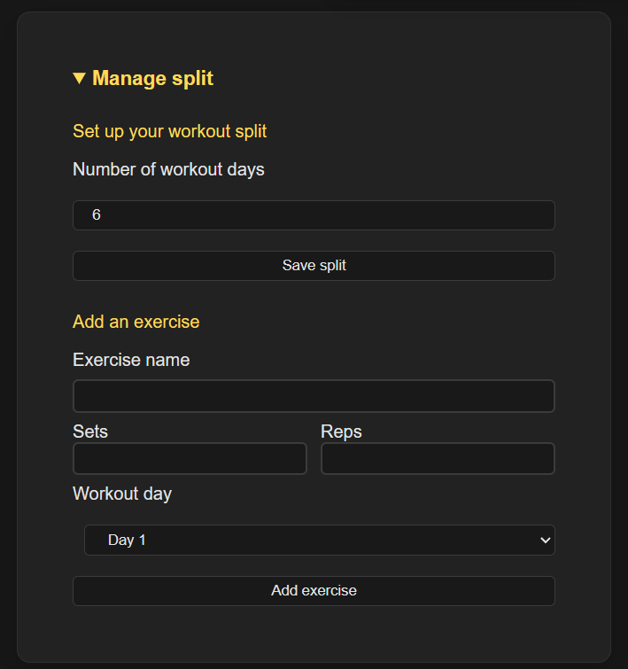

# Gym Tracker

A full-stack workout tracker for lifters who train on a custom split. Build your own program, log every set, and see what you lifted last time right when you're about to lift it again.

**Live demo:** https://repandlog.com  
**Stack:** Node.js · Express 5 · SQLite (better-sqlite3) · Resend (transactional email)

## Screenshots

| Workout day | Logging a session | Manage split |
|---|---|---|
|  |  |  |

---

## Features

**Training**
- **Custom splits:** choose a split length from 1 to 14 days; it's saved to your account and follows you across devices.
- **Per-day programming:** assign exercises to workout days with their own target sets and reps. The same lift can have different prescriptions on different days (for example, heavy squats on Day 1 and volume squats on Day 4).
- **Session logging:** start a session for the day, then log weight and reps for each exercise. Logs can be edited or deleted.
- **Last performance at a glance:** each exercise shows your most recent logged weight and reps, even if you last did it on a different split day.
- **Calendar lookup:** pull up any past date to review what you did.
- **History-safe edits:** removing an exercise from a day only detaches it; your logged history is preserved. Sessions that contain logs can't be deleted by accident.

**Frontend**
- Built with plain HTML, CSS, and JavaScript, with DOM rendering and `fetch` calls to the REST API and no frontend framework or build step.
- Single-page flow with an animated sign-in / sign-up card, plus in-page password-recovery and reset-password views.
- Inline editing and delete confirmations for exercises and logs, so you never leave the page mid-workout.
- Dark, responsive layout (CSS Grid and Flexbox) with a dedicated mobile breakpoint, so it works at the gym on a phone.
- Accessible touches: labeled form controls and an `aria-live` region for status and error notifications.
- Session dates use the browser's local calendar date, so late-night workouts aren't shifted by UTC.

**Accounts and security**
- Email and password sign-up with **email verification** required before first sign-in.
- **Password reset** via a one-hour, single-use emailed link. Resetting revokes all existing sessions on every device.
- Passwords hashed with **scrypt** and a unique per-user salt, compared in constant time.
- Session, verification, and reset tokens are random 256-bit values; only their **SHA-256 digests** are stored, so a leaked database can't be used to hijack accounts.
- Session cookies are `HttpOnly`, `SameSite=Lax`, and `Secure` in production.
- **Layered rate limiting** with tighter limits on login and password-recovery endpoints.
- Generic responses on login, resend, and forgot-password so the API doesn't reveal which emails have accounts.
- Every query is scoped to the signed-in user, so one user can't read or modify another's data by guessing IDs.
- Production config is validated at startup; the server refuses to boot with missing email or URL settings.

---

## Tech Stack

| Layer | Choice |
|---|---|
| Runtime / server | Node.js, Express 5 |
| Database | SQLite via `better-sqlite3` (WAL mode, foreign keys enforced) |
| Email | Resend REST API |
| Rate limiting | `express-rate-limit` |
| Config | `dotenv` |
| Frontend | Vanilla HTML, CSS, and JavaScript (no framework), served statically from `public/` |

---

## Data Model

```
users ──┬── auth_sessions
        ├── email_verification_tokens
        ├── password_reset_tokens
        ├── exercises ──┬── junction (day ↔ exercise, target sets/reps)
        │               └── logs (weight, reps)
        └── sessions ───────┘
```

- `exercises` is a user's personal lift library.
- `junction` is the many-to-many link between workout days and exercises, and stores the per-day sets/reps targets.
- `sessions` is one workout on one date; `logs` are the individual weight/reps entries inside it.
- All child tables use `ON DELETE CASCADE`, and `CHECK` / `UNIQUE` constraints enforce valid data at the database level.
- `db.js` includes a small migration that moved set/rep targets from `exercises` onto `junction`, so existing databases upgrade in place on startup.

---

## API Overview

**Auth (public):**

| Method | Route | Purpose |
|---|---|---|
| POST | `/auth/signup` | Create an unverified account and send a verification email |
| GET | `/auth/verify?token=` | Consume the verification link and sign in |
| POST | `/auth/login` | Sign in (verified accounts only) |
| POST | `/auth/logout` | Delete the server-side session |
| GET | `/auth/me` | Restore the signed-in user from the cookie |
| POST | `/auth/resend-verification` | Send a fresh verification link |
| POST | `/auth/forgot-password` | Send a password reset link |
| POST | `/auth/reset-password` | Set a new password and revoke all sessions |

**App (requires sign-in):**

| Method | Route | Purpose |
|---|---|---|
| PATCH | `/users/me/split` | Update split length |
| GET | `/days/:day` | Exercises for a day with their latest logged performance |
| POST | `/exercises` | Create or reuse an exercise and assign it to a day |
| PATCH | `/exercises/:id` | Rename an exercise or update a day's targets |
| DELETE | `/days/:day/exercises/:id` | Remove an exercise from a day (history kept) |
| POST | `/sessions` | Start a workout session for a date |
| GET | `/sessions/:date` | Session and logs for a date |
| GET | `/sessions/:id/day/:day` | Exercises not yet logged in a session |
| DELETE | `/sessions/:id` | Delete an empty session |
| POST | `/logs` | Log weight and reps |
| PATCH | `/logs/:id` | Edit a log |
| DELETE | `/logs/:id` | Delete a log |

---

## Getting Started

**Requirements:** Node.js 20+ (check `better-sqlite3`'s supported versions) and npm.

```bash
git clone https://github.com/SanadAtia1/gym-tracker.git
cd gym-tracker
npm install
cp .env.example .env
npm start
```

Open http://localhost:3000.

In development, no email provider is needed. Verification and password-reset links are printed to the server console (and returned to the frontend) so you can test the full flow locally.

### Environment Variables

| Variable | Required in production | Description |
|---|---|---|
| `NODE_ENV` | yes | Set to `production` to enable Secure cookies and startup checks |
| `PORT` | no | Defaults to `3000` |
| `APP_URL` | yes | Public base URL, must start with `https://`; used in emailed links |
| `RESEND_API_KEY` | yes | API key from [Resend](https://resend.com) |
| `EMAIL_FROM` | yes | Sender, e.g. `Gym Tracker <noreply@yourdomain.com>` |
| `TRUST_PROXY` | recommended | Set to `true` behind a reverse proxy so rate limiting sees real client IPs |
| `DB_PATH` | recommended | Path to the SQLite file; point it at persistent storage |

In production, point `DB_PATH` at a persistent disk or volume (SQLite is a single file) and run a single instance.
